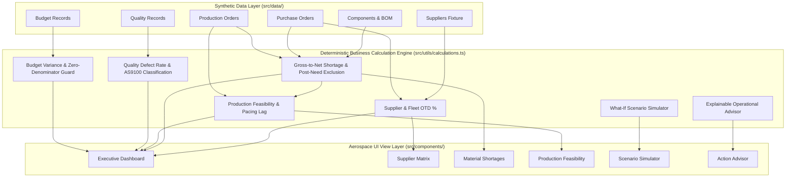

# AeroOps Control Tower

> **Aerospace Manufacturing Operations Decision-Support System**  
> *Independent Portfolio Demonstration Project — Prepared for Tata Advanced Systems Limited (TASL) Management Trainee Operations Focus*

[](https://aerops-eight.vercel.app/)
[](https://www.typescriptlang.org/)
[](https://react.dev/)
[](https://tailwindcss.com/)
[](https://vitest.dev/)
[](LICENSE)

🚀 **Live Interactive Demo:** [https://aerops-eight.vercel.app/](https://aerops-eight.vercel.app/)

---

## 1. Executive Summary & Problem Statement

In high-reliability aerostructures, defense, and precision aerospace assembly, production line continuity depends on synchronization across:
1. Multi-tier global and domestic suppliers (Tier-1 and Tier-2).
2. Multi-level Bills of Materials (BOM) with long-lead raw materials (e.g., aerospace-grade titanium forgings, carbon fiber composites, mil-spec avionics).
3. Rigid customer delivery milestones (Final Assembly Line - FAL need dates).
4. Zero-defect aerospace quality tolerances (AS9100 standard).

When an upstream forging supplier faces a 14-day delay or an incoming lot fails metallurgical inspection, operations managers cannot wait for end-of-month ERP reports. They require **real-time gross-to-net inventory explosion**, **downstream assembly impact mapping**, and **what-if simulation** to balance expediting costs against line stoppage penalties.

**AeroOps Control Tower** provides that capability as a deterministic, client-side operations decision-support system.

> **Operational Notice & Disclaimer:**  
> AeroOps Control Tower is an independent technical demonstration and portfolio project. It uses purely fictional, synthetic aerospace manufacturing data. It contains no confidential information, does not claim access to proprietary systems of Tata Advanced Systems Limited (TASL), and does not represent an official TASL product. All operational recommendations are advisory and require human supervisor authorization.

---

## 2. Core Capabilities & Feature Overview

| Capability | Module | Practical Operations Value |
| :--- | :--- | :--- |
| **Operational Health Dashboard** | `ExecutiveDashboardView` | 5 core operational KPIs (Fleet OTD %, Shortage Count, At-Risk Production Orders, Inspection Defect Rate, Net Budget Variance) with trend indicators, rolling 6-week OTD trendlines, defect category breakdowns, and commodity budget variances. |
| **Supplier Performance Matrix** | `SupplierPerformanceView` | Sortable, searchable scorecard evaluating lead-time compliance, defect rates, tier classifications, and transparent heuristic risk scoring with slide-out drill-down drawers. |
| **Inventory & Shortage Analyzer** | `MaterialShortageView` | Gross-to-net component explosion calculating free on-hand stock, active BOM requirements, eligible scheduled receipts, and financial shortage exposure in USD. |
| **Production Order Feasibility** | `ProductionFeasibilityView` | Shop floor order monitoring with pacing lag diagnostics, assembly progress tracking, and full BOM component availability drill-downs. |
| **What-If Scenario Simulator** | `ScenarioSimulatorView` | Dynamic sensitivity simulator allowing managers to model lead-time delays (+0 to +30 days), scrap surges (0% to 25%), air freight expedites, and secondary supplier buffers with real-time delta KPIs. |
| **Explainable Action Advisor** | `ExplainableActionsView` | Prioritized, practical operational recommendations articulating root causes, downstream impacts, and actionable recovery steps with supervisor acknowledgement tracking. |

---

## 3. System Architecture & Data Flow

The system uses a strictly deterministic, unidirectional data architecture. All domain transformations are pure functions verified by automated tests.



---

## 4. Business Logic & Mathematical Formulas

Every metric in AeroOps Control Tower follows precise aerospace manufacturing definitions documented in [`docs/BUSINESS_RULES.md`](docs/BUSINESS_RULES.md):

### 1. Supplier On-Time Delivery Rate (OTD %)
$$\text{OTD \%} = \left( \frac{\text{Eligible Orders Delivered on or before Expected Date}}{\text{Total Orders Due up to Cutoff Date}} \right) \times 100$$
- **Eligibility:** Orders due in the future relative to the system cutoff date (`2026-10-15`) are excluded from the denominator.
- **Cancelled Orders:** Excluded from the denominator to prevent commercial cancellations from penalizing supplier reliability.
- **Zero-Denominator:** When eligible due orders equal zero, the engine returns `100.0%` with `hasEligibleData = false`.

### 2. Quality Defect Rate (%)
$$\text{Defect Rate \%} = \left( \frac{\min(\text{Rejected Units}, \text{Inspected Units})}{\text{Inspected Units}} \right) \times 100$$
- Safely handles zero inspection cases (`hasInspections = false`) without returning `NaN`.
- Clamps negative values or oversized rejections defensively.

### 3. Net Component Shortage & Temporal Receipt Rule
$$\text{Free On-Hand} = \max(0, \text{On-Hand} - \text{Allocated})$$
$$\text{Gross Requirement} = \sum_{\text{Active Orders}} (\text{Planned Quantity} \times \text{Quantity Per Assembly})$$
$$\text{Net Shortage} = \max(0, \text{Gross Requirement} - (\text{Free On-Hand} + \text{Valid Scheduled Receipts}))$$
- **The Temporal Need-Date Rule:** Scheduled receipts (open purchase orders) are **only** counted as valid supply if their expected arrival date is on or before the assembly's planned start date:
  $$\text{Valid PO} \iff \text{expectedDeliveryDate} \le \text{plannedStartDate}$$
  Receipts arriving even one day after the assembly start date are excluded, reflecting true line stoppage risk.

### 4. Production Order Risk & Pacing Lag
- **Material Shortage Risk:** Triggered if any required BOM component has a net shortage $> 0$.
- **Pacing Lag:** Triggered if the planned start date has elapsed (`cutoffDate > plannedStartDate`) with 0 completed units on an active order.
- **Critical Milestone Breach:** Incomplete orders past their required completion date are classified as `critical`.

### 5. Heuristic Supplier Risk Score
A transparent 0–100 risk score combining weighted operational vulnerabilities:
$$\text{Score} = (100 - \text{OTD}) \times 0.40 + (\text{Defect Rate} \times 5) \times 0.35 + \text{Lead-Time Gap Factor} \times 0.25$$

---

## 5. Walkthrough: The Titanium Bulkhead Ring Scenario

To observe how AeroOps Control Tower supports operational decision-making, follow this standard workflow:

```
[1. Executive Dashboard]
  │  Fleet OTD at 77.8% (Target 90.0%). 2 Active Shortages. 3 At-Risk Orders.
  ▼
[2. Inventory Shortage View]
  │  Component: CMP-TIT-01 (Titanium Bulkhead Ring, Tier-1 Structural).
  │  Free On-Hand: 10 EA. Gross Requirement: 16 EA (PRD-2026-001 Wing Assembly).
  │  Net Shortage: 6 EA ($30,000 financial exposure).
  │  Receipt Analysis: PO-008 (10 EA from Bharat Forge Aerostructures) is delayed
  │  to 2026-11-05. Since PRD-2026-001 starts 2026-10-20, PO-008 is disqualified!
  ▼
[3. Production Feasibility View]
  │  PRD-2026-001 is flagged as CRITICAL AOG due to CMP-TIT-01 shortage.
  ▼
[4. What-If Scenario Simulator]
  │  Action 1: Toggle "Expedite Delayed POs via Air Freight".
  │  Result: PO-008 is expedited to arrive on cutoff date (2026-10-15).
  │  Outcome: Net shortage on CMP-TIT-01 drops from 6 to 0 EA; PRD-2026-001 risk clears!
  │  Action 2: Toggle "Dual-Sourcing Safety Buffer".
  │  Result: Secondary vendor allocation (Kalyani Technoforge) buffers stock by +20%.
  ▼
[5. Explainable Action Advisor]
  │  Recommendation REC-001: "Expedite Purchase Order PO-008 via Air Freight"
  │  Root Cause: Bharat Forge machine calibration delay.
  │  Financial Impact: Mitigates $30,000 raw material gap and prevents $120,000 line stoppage.
  │  Operations Manager clicks "Acknowledge Recommendation" for execution tracking.
```

---

## 6. Technology Stack & Performance Optimizations

- **Framework & Language:** React 19, TypeScript 6.0 (Strict Mode, zero `any`).
- **Build Tooling:** Vite 8 with Rollup manual code-splitting.
- **Styling:** Tailwind CSS v4 with curated dark industrial palette (`slate-950` background, high-contrast text, accessible focus rings).
- **Data Visualizations:** Recharts (Responsive rolling trendlines, stacked bars).
- **Icons:** Lucide React (`lucide-react`).
- **Test Framework:** Vitest (47 unit and edge-case tests executing in ~170ms).
- **Code Splitting & Bundle Performance:**
  - Initial entry JavaScript bundle: **39.0 kB** (11.3 kB gzipped).
  - Isolated vendor chunks: `vendor-react` (64.9 kB gzip), `vendor-charts` (115 kB gzip), `vendor-icons` (4.6 kB gzip).
  - On-demand route chunks: Each view is lazy-loaded between 7 kB and 19 kB.
  - Zero chunk warnings during production build.

---

## 7. Local Installation & Verification Commands

### Prerequisites
- Node.js 20+ (tested on Node v22.22)
- npm 10+

### Step-by-Step Execution
```bash
# 1. Clone repository
git clone https://github.com/udaydomadiya08/aerops.git
cd aerops

# 2. Install dependencies
npm install

# 3. Verify TypeScript types (Strict type check)
npm run typecheck

# 4. Run automated test suite (47 unit & edge case tests)
npm test

# 5. Run static code quality linter
npm run lint

# 6. Build production bundle
npm run build

# 7. Preview production build locally
npm run preview
```

---

## 8. Deployment Configuration (Vercel & Static Hosts)

- **Production Live URL:** [https://aerops-eight.vercel.app/](https://aerops-eight.vercel.app/)
- **Hosting Platform:** Vercel (Edge Network)
- **Deployment Status:** Active & Verified

### Pre-Configured Files
- [`vercel.json`](vercel.json): Configures single-page application (SPA) rewrites (`/(.*) -> /index.html`) and long-term immutable caching headers for static assets (`/assets/(.*)`).

### Deploying to Vercel via CLI
```bash
# Deploy preview build
npx vercel

# Deploy directly to production
npx vercel --prod
```

### Deploying via GitHub Git Integration
1. Push this repository to GitHub: `https://github.com/udaydomadiya08/aerops`.
2. Log in to [vercel.com](https://vercel.com) and click **"Add New Project"**.
3. Import the `udaydomadiya08/aerops` repository.
4. Framework Preset will auto-detect **Vite**.
5. Build Command: `npm run build`; Output Directory: `dist`.
6. Click **Deploy**.

---

## 9. Known Limitations & Non-Goals

1. **Client-Side Simulation:** The application runs entirely in the browser using pre-packaged, validated synthetic fixtures. It does not connect to live backend servers or third-party paid APIs.
2. **Advisory Decision Support:** In compliance with aerospace governance principles, all operational recommendations are strictly advisory. The system does not automatically issue procurement purchase orders or modify MRP master schedules without human supervisor confirmation.
3. **Synthetic Scope:** Supplier names, component part numbers, and financial costs are realistic synthetic representations modeled after aerospace manufacturing best practices.

---

## 10. Repository Documentation Index

Detailed engineering documentation is available in the [`docs/`](docs/) directory:

- [`docs/PRODUCT_SPEC.md`](docs/PRODUCT_SPEC.md) — Comprehensive product specification, user personas, operational use cases, and design constraints.
- [`docs/ARCHITECTURE.md`](docs/ARCHITECTURE.md) — Technical architecture, unidirectional state flow, directory layout, and performance guidelines.
- [`docs/BUSINESS_RULES.md`](docs/BUSINESS_RULES.md) — Formal mathematical definitions, edge-case handlers, and metric rules.
- [`docs/DATA_DICTIONARY.md`](docs/DATA_DICTIONARY.md) — Relational schema definitions, entity relationships, and validation constraints.
- [`docs/ROADMAP.md`](docs/ROADMAP.md) — Four-phase delivery roadmap and complete acceptance checklists.

---

## 11. License & Author

- **License:** [MIT License](LICENSE) (Open-source portfolio demonstration)
- **Author:** Uday Domadiya
- **Repository:** [https://github.com/udaydomadiya08/aerops](https://github.com/udaydomadiya08/aerops)
