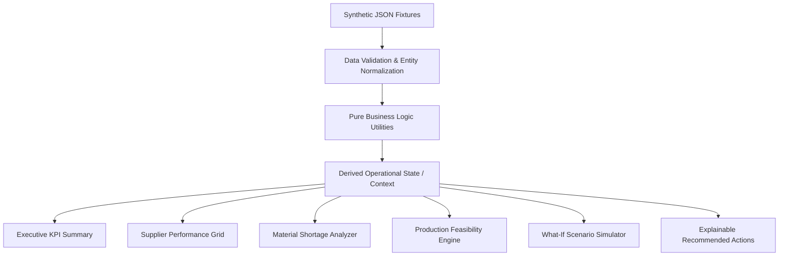

# AeroOps Control Tower — System Architecture

## 1. Architectural Philosophy & Principles

AeroOps Control Tower is engineered around four core tenets:

1. **Deterministic Calculations:** All operational KPIs, inventory shortages, and risk ratings are derived through pure, side-effect-free TypeScript functions. Given identical inputs, calculations produce identical outputs.
2. **Predictable Data Flow:** Single-direction data flow. Raw synthetic fixtures -> Domain Validation & Normalization -> Pure Calculation Layer -> Application State -> UI Presentation Layer.
3. **Zero External Infrastructure Overhead:** Runs fully in-browser without requiring cloud databases, external API keys, Docker containers, or microservices, ensuring smooth execution on any development workstation or laptop.
4. **Transparent Explainability:** Every flagged risk and KPI links directly to an explainable formula, documented assumption, and underlying data records.

---

## 2. Technology Stack & Rationale

| Layer | Technology | Version | Rationale |
| :--- | :--- | :--- | :--- |
| **Framework** | React | 19.x | Component-based UI with standard state management and high rendering performance. |
| **Language** | TypeScript | 6.x | Strict type checking (`strict: true`) guarantees type safety across domain models and arithmetic routines. |
| **Build & Bundler** | Vite | 8.x | Extremely fast Hot Module Replacement (HMR) and optimized rollup production bundles. |
| **Styling** | Tailwind CSS | v4.x | Utility-first CSS tailored with an aerospace industrial palette (navy `#0B192C`, slate `#1E293B`, subdued alerts). |
| **Icons** | Lucide React | 1.x | Standardized, accessible, clean SVG iconography. |
| **Charts** | Recharts | 3.x | Declarative, SVG-based charting compatible with modern React lifecycle. |
| **Unit Testing** | Vitest | 5.x | High-speed, native Vite test runner for deterministic arithmetic and domain logic testing. |

---

## 3. Directory Layout

The codebase follows a clear, domain-driven structure:

```
aerrops/
├── docs/                       # Comprehensive specifications and documentation
│   ├── PRODUCT_SPEC.md         # Operational requirements, user personas, non-goals
│   ├── ARCHITECTURE.md         # Technical architecture and design choices (this file)
│   ├── BUSINESS_RULES.md       # Exact mathematical definitions and safety rules
│   ├── DATA_DICTIONARY.md      # Entity schemas, field constraints, relationships
│   └── ROADMAP.md              # 4-phase delivery plan and acceptance criteria
├── public/                     # Static assets, aerospace logo, favicon
├── src/
│   ├── assets/                 # SVGs and images
│   ├── components/             # Reusable UI presentation components
│   │   ├── common/             # Badges, Cards, Tooltips, Buttons
│   │   ├── layout/             # Header, Navigation, Footer, Container
│   │   └── shell/              # Foundation shell views & system health indicators
│   ├── data/                   # Coherent synthetic JSON domain fixtures
│   │   ├── suppliers.json      # Tier-1 & Tier-2 aerospace suppliers
│   │   ├── components.json     # Material & component master inventory
│   │   ├── purchaseOrders.json # Purchase orders with scheduled and actual dates
│   │   ├── productionOrders.json# Assembly work orders with BOM requirements
│   │   ├── qualityRecords.json # Receiving inspection and defect logs
│   │   └── budgetRecords.json  # Departmental procurement budgets vs actuals
│   ├── types/                  # Strict TypeScript domain models & interfaces
│   │   ├── domain.ts           # Core entity types (Supplier, Component, PO, etc.)
│   │   └── calculations.ts     # Metric calculation result interfaces
│   ├── utils/                  # Pure calculation functions and safety guards
│   │   ├── calculations.ts     # OTD, defect rate, shortage, risk, variance
│   │   ├── formatting.ts       # Currency, date, percentage formatters
│   │   └── __tests__/          # Vitest test suites
│   │       └── calculations.test.ts # Comprehensive edge-case test suite
│   ├── App.tsx                 # Main application shell with navigation tabs
│   ├── index.css               # Core design tokens and Tailwind imports
│   └── main.tsx                # React application entry point
├── package.json                # Project dependencies and scripts
├── tsconfig.json               # Root TypeScript configuration
├── tsconfig.app.json           # Application TypeScript config (strict mode)
└── vite.config.ts              # Vite configuration with Tailwind CSS plugin
```

---

## 4. End-to-End Data Pipeline



### Data Pipeline Stages:
1. **Fixture Ingestion:** Baseline data loaded from synthetic JSON fixtures representing a typical aerospace sub-assembly plant.
2. **Entity Validation:** Guard rails ensure non-negative stock counts, chronological dates (`deliveryDate >= orderDate`), and foreign key validity (e.g. `supplierId` in PO exists in Suppliers).
3. **Calculation Engine:** Pure functions compute derived values:
   - On-Time Delivery % per supplier and fleet-wide.
   - Defect rate % per supplier and component.
   - Net inventory shortage factoring in valid scheduled receipts.
   - Assembly order feasibility tagging.
   - Budget variances.
4. **Scenario Overrides (Phase 2):** User-adjusted simulation parameters (e.g. +10 days lead time delay) re-run calculations in memory without mutating base data.
5. **UI Rendering:** React components consume the computed state and render responsive views.

---

## 5. State Management Strategy

To prevent unnecessary complexity or external state library bloat:
- **Baseline Data:** Ingested synchronously as immutable data structures.
- **Scenario Simulation State:** Managed via a lightweight React Context or custom hook (`useOperationsData`).
- **UI State (Tabs, Filters, Sort, Search):** Managed via local React state (`useState`), keeping the application snappy and responsive.

---

## 6. Safety, Quality & Error Handling

- **Division by Zero Protection:** All percentage formulas explicitly check denominators; returns `0` or `null` with explicit `hasEligibleData: false` flags.
- **Negative Value Prevention:** Inventory availability and shortages are bounded by `Math.max(0, ...)`.
- **Date Comparison Integrity:** ISO string comparisons (`YYYY-MM-DD`) or timestamp conversions prevent timezone-induced date skewing.
- **No Silent Fallbacks:** Missing values are surfaced clearly as `"N/A"` or `"Unspecified"` rather than falsely recorded as `0`.
