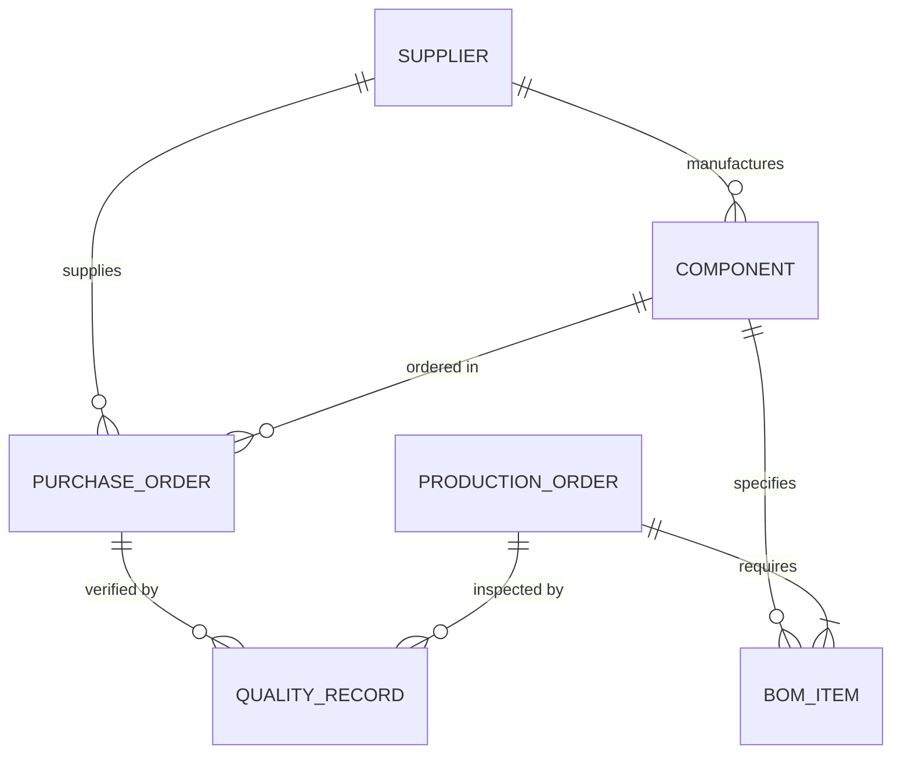

# AeroOps Control Tower — Data Dictionary & Domain Schemas

## 1. Overview

This document specifies the schemas, attributes, data types, constraints, and relationships for all entities in the AeroOps Control Tower domain model.

---

## 2. Entity Schemas

### 2.1 Supplier (`Supplier`)
Represents an external aerospace vendor supplying raw materials, fasteners, or sub-tier assemblies.

| Field | Type | Required | Constraints | Description |
| :--- | :--- | :---: | :--- | :--- |
| `id` | `string` | Yes | Unique, prefix `SUP-` | Supplier identifier (e.g. `SUP-001`) |
| `name` | `string` | Yes | Non-empty | Registered company name |
| `tier` | `'Tier 1' \| 'Tier 2'` | Yes | Enum | Aerospace supply chain tier |
| `category` | `string` | Yes | Non-empty | Primary commodity (e.g. `Raw Materials & Alloys`) |
| `suppliedComponentIds` | `string[]` | Yes | Valid component references | Components qualified for this supplier |
| `ordersPlaced` | `number` | Yes | Integer $\ge 0$ | Total purchase orders placed to date |
| `ordersDeliveredOnTime`| `number` | Yes | Integer $\ge 0$, $\le$ ordersPlaced | Orders delivered on or before due date |
| `totalUnitsReceived` | `number` | Yes | Integer $\ge 0$ | Cumulative physical units received |
| `rejectedUnits` | `number` | Yes | Integer $\ge 0$, $\le$ totalUnitsReceived | Cumulative units rejected at QA |
| `leadTimeDaysAvg` | `number` | Yes | $\ge 0$ | Rolling average lead time in days |
| `contractedLeadTimeDays`| `number`| Yes | $> 0$ | Contractual baseline lead time in days |
| `status` | `'active' \| 'watch' \| 'critical'` | Yes | Enum | Administrative vendor status |
| `location` | `string` | Yes | Non-empty | City and country of primary manufacturing facility |

---

### 2.2 Component & Inventory (`Component`)
Represents a physical part, raw material, or hardware item held in warehouse stock or scheduled for delivery.

| Field | Type | Required | Constraints | Description |
| :--- | :--- | :---: | :--- | :--- |
| `id` | `string` | Yes | Unique, prefix `CMP-` | Part number identifier (e.g. `CMP-TIT-01`) |
| `name` | `string` | Yes | Non-empty | Standard aerospace engineering part name |
| `category` | `'Structural' \| 'Fasteners' \| 'Avionics' \| 'Composites' \| 'Propulsion'` | Yes | Enum | Technical part categorization |
| `unitOfMeasure` | `'EA' \| 'KG' \| 'M' \| 'SET'` | Yes | Enum | Standardized unit of count/measure |
| `onHandQuantity` | `number` | Yes | $\ge 0$ | Total physical inventory in warehouse bins |
| `allocatedQuantity` | `number` | Yes | $\ge 0$, $\le$ onHandQuantity | Stock committed to active production work orders |
| `reorderThreshold` | `number` | Yes | $> 0$ | Min replenishment trigger point |
| `safetyStock` | `number` | Yes | $\ge 0$ | Buffer to absorb supplier lead time spikes |
| `leadTimeDays` | `number` | Yes | $> 0$ | Standard procurement lead time in days |
| `primarySupplierId` | `string` | Yes | Valid `Supplier.id` | Primary source vendor |
| `secondarySupplierIds`| `string[]`| Yes | Valid `Supplier.id`s | Dual-source or alternate approved vendors |
| `unitCostUSD` | `number` | Yes | $> 0$ | Standard unit procurement cost |

---

### 2.3 Purchase Order (`PurchaseOrder`)
Represents a procurement commitment to a supplier for a specified component quantity and target dock date.

| Field | Type | Required | Constraints | Description |
| :--- | :--- | :---: | :--- | :--- |
| `id` | `string` | Yes | Unique, prefix `PO-` | Purchase order identifier (e.g. `PO-2026-101`) |
| `supplierId` | `string` | Yes | Valid `Supplier.id` | Vendor receiving the order |
| `componentId` | `string` | Yes | Valid `Component.id` | Item being ordered |
| `orderedQuantity` | `number` | Yes | Integer $> 0$ | Total quantity contracted |
| `receivedQuantity` | `number` | Yes | Integer $\ge 0$ | Total quantity delivered to receiving dock |
| `orderDate` | `string` | Yes | ISO 8601 (`YYYY-MM-DD`) | Date PO was placed |
| `expectedDeliveryDate` | `string` | Yes | ISO 8601, $\ge$ orderDate | Contractual promise date |
| `actualDeliveryDate` | `string \| null` | No | ISO 8601 or null if pending | Actual receiving dock date |
| `status` | `'pending' \| 'in_transit' \| 'delivered' \| 'delayed' \| 'cancelled'` | Yes | Enum | Operational lifecycle status |
| `expedited` | `boolean` | Yes | Boolean flag | Whether order was expedited via air freight |

---

### 2.4 Production Order (`ProductionOrder`)
Represents an aerostructure assembly, sub-system, or line work order.

| Field | Type | Required | Constraints | Description |
| :--- | :--- | :---: | :--- | :--- |
| `id` | `string` | Yes | Unique, prefix `PRD-` | Work order identifier (e.g. `PRD-2026-088`) |
| `assemblyCode` | `string` | Yes | Unique code (e.g. `ASY-WNG-88`) | Product code identifier |
| `assemblyName` | `string` | Yes | Non-empty | Formal assembly name (e.g. `Fighter Jet Wing Spar Assembly`) |
| `plannedQuantity` | `number` | Yes | Integer $> 0$ | Target production batch quantity |
| `completedQuantity` | `number` | Yes | Integer $\ge 0$, $\le$ plannedQuantity | Units finished through quality signoff |
| `plannedStartDate` | `string` | Yes | ISO 8601 | Scheduled start date on shop floor |
| `requiredCompletionDate`| `string`| Yes | ISO 8601, $\ge$ plannedStartDate | Customer contractual delivery milestone |
| `billOfMaterials` | `BOMItem[]` | Yes | Non-empty array | Required parts per assembly unit |
| `status` | `'scheduled' \| 'in_progress' \| 'delayed' \| 'completed' \| 'on_hold'` | Yes | Enum | Work order execution status |
| `priority` | `'standard' \| 'high' \| 'critical_aog'` | Yes | Enum | AOG (Aircraft On Ground) / Line priority |

#### Nested Structure: `BOMItem`
- `componentId`: `string` (Foreign key -> `Component.id`)
- `quantityPerAssembly`: `number` (Integer $> 0$)

---

### 2.5 Quality Inspection Record (`QualityRecord`)
Represents an AS9100 receiving inspection or stage inspection report.

| Field | Type | Required | Constraints | Description |
| :--- | :--- | :---: | :--- | :--- |
| `id` | `string` | Yes | Unique, prefix `QC-` | Quality inspection number (e.g. `QC-2026-301`) |
| `referenceType` | `'purchase_order' \| 'production_order'` | Yes | Enum | Inspection source context |
| `referenceId` | `string` | Yes | Valid PO or PRD ID | Tracking reference |
| `componentId` | `string` | Yes | Valid `Component.id` | Inspected part ID |
| `inspectedQuantity` | `number` | Yes | Integer $> 0$ | Total units sampled/inspected |
| `rejectedQuantity` | `number` | Yes | Integer $\ge 0$, $\le$ inspected | Non-conforming units rejected |
| `inspectionDate` | `string` | Yes | ISO 8601 | Date inspection performed |
| `defectType` | `'dimensional' \| 'metallurgical' \| 'surface_finish' \| 'documentation' \| 'none'` | Yes | Enum | Defect root category |
| `disposition` | `'accepted' \| 'rework' \| 'scrap' \| 'concession'` | Yes | Enum | Final QA disposition |

---

### 2.6 Budget Record (`BudgetRecord`)
Represents periodic procurement and operational budgets.

| Field | Type | Required | Constraints | Description |
| :--- | :--- | :---: | :--- | :--- |
| `id` | `string` | Yes | Unique, prefix `BDG-` | Budget line identifier |
| `period` | `string` | Yes | Format `YYYY-Q#` or `YYYY-MM` | Fiscal tracking period (e.g. `2026-Q1`) |
| `category` | `string` | Yes | Non-empty | Operational cost category |
| `budgetAmount` | `number` | Yes | $\ge 0$ | Approved budget allocation ($) |
| `actualExpenditure` | `number` | Yes | $\ge 0$ | Incurred actual spend ($) |

---

## 3. Entity Relationships Diagram

---

## 4. Integrity and Validation Rules

1. **Foreign Key Validity:** All `supplierId`, `componentId`, and reference IDs must match existing records in the corresponding master fixtures.
2. **Date Chronology:** For all Purchase Orders, `expectedDeliveryDate >= orderDate`. If `actualDeliveryDate` is present, it must be $\ge orderDate$.
3. **Quantity Non-Negativity:** All inventory balances (`onHandQuantity`, `allocatedQuantity`, `safetyStock`, `orderedQuantity`) must be non-negative.
4. **Allocation Ceiling:** $\text{allocatedQuantity} \le \text{onHandQuantity}$.
5. **Rejection Ceiling:** In quality records, $\text{rejectedQuantity} \le \text{inspectedQuantity}$.
